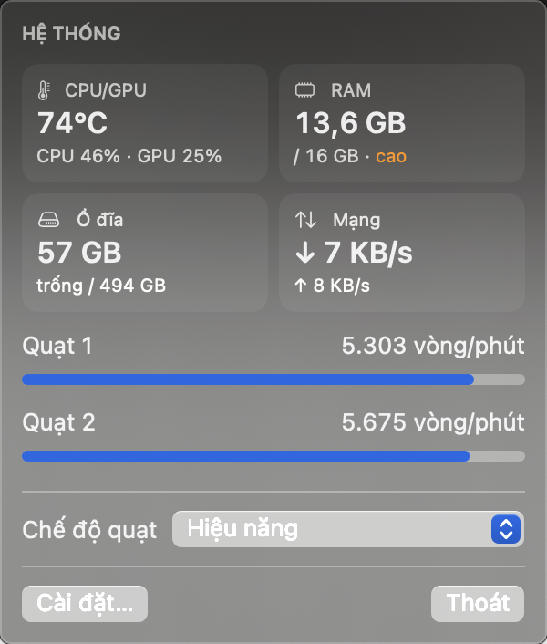
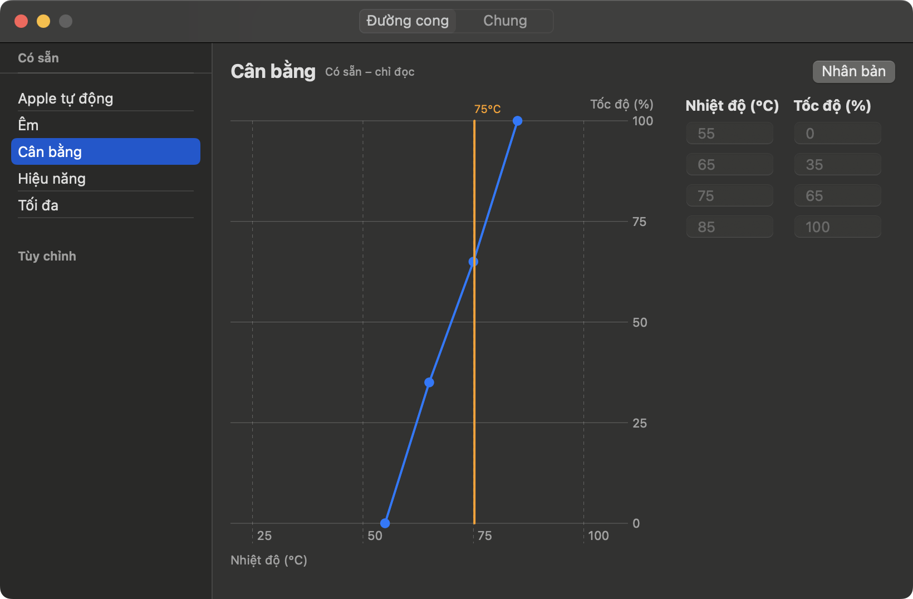

# Fan Control

App menu bar tự chỉnh tốc độ quạt MacBook Apple Silicon (M1/M2) theo nhiệt độ CPU/GPU, kèm theo dõi nhanh CPU, GPU, RAM, ổ đĩa và mạng.

  

## Tải về

**[⬇ Tải bản mới nhất (FanControl.dmg)](https://github.com/nguyentienloc/my-mac-fan-controls/releases/latest)**

Yêu cầu: macOS 14 trở lên, Mac Apple Silicon. App đã được ký và Apple notarize, mở được ngay sau khi tải.

## Cài đặt

1. Mở file `.dmg` vừa tải, kéo **FanControl** vào thư mục **Applications**.
2. **Thoát Macs Fan Control** (hoặc app chỉnh quạt khác) nếu đang chạy, để hai app không tranh nhau điều khiển quạt.
3. Mở **FanControl** (⌘ + Space → gõ "FanControl"). App không có cửa sổ hay icon Dock: nó hiện icon quạt kèm nhiệt độ ở **góc phải thanh menu**. Nếu không thấy, có thể icon bị tai thỏ che — hãy bớt icon khác trên thanh menu.
4. Click icon quạt → **Cài đặt helper** → nhập mật khẩu máy. Helper chạy nền để chỉnh tốc độ quạt; chỉ cần cài một lần.

## Sử dụng

Click icon quạt trên thanh menu để mở popover:

- **Hệ thống**: nhiệt độ CPU/GPU, % CPU và % GPU, RAM đã dùng (kèm áp lực bộ nhớ: bình thường / cao / nguy hiểm), dung lượng ổ đĩa còn trống, tốc độ mạng tải xuống / tải lên.
- **Quạt**: tốc độ hiện tại của từng quạt.
- **Chế độ quạt**: chọn nhanh trong menu xổ xuống.

| Chế độ | Hành vi |
|---|---|
| Apple tự động | macOS tự điều khiển quạt |
| Êm | 65°C→0%, 75°C→30%, 85°C→60%, 92°C→100% |
| Cân bằng | 55°C→0%, 65°C→35%, 75°C→65%, 85°C→100% |
| Hiệu năng | 45°C→20%, 60°C→50%, 70°C→80%, 78°C→100% |
| Tối đa | luôn chạy 100% |

Dưới điểm đầu tiên của đường cong, quạt được trả về cho Apple (có thể dừng hẳn khi máy mát). Ở mọi chế độ, khi nhiệt độ ≥ 95°C quạt luôn chạy tối đa.

### Tự tạo đường cong

**Cài đặt… → Đường cong** → chọn một chế độ có sẵn → **Nhân bản**, rồi kéo các điểm trên biểu đồ hoặc nhập số trong bảng, đặt tên và bấm **Lưu**. Chế độ mới xuất hiện trong menu chọn nhanh.

  

Bật **Mở khi đăng nhập** trong **Cài đặt… → Chung**. Kể cả khi không mở app, helper vẫn điều khiển quạt theo chế độ đã chọn.

## Gỡ cài đặt

**Cài đặt… → Chung → Gỡ helper** (quạt trở về chế độ của Apple), rồi xóa `/Applications/FanControl.app`.
